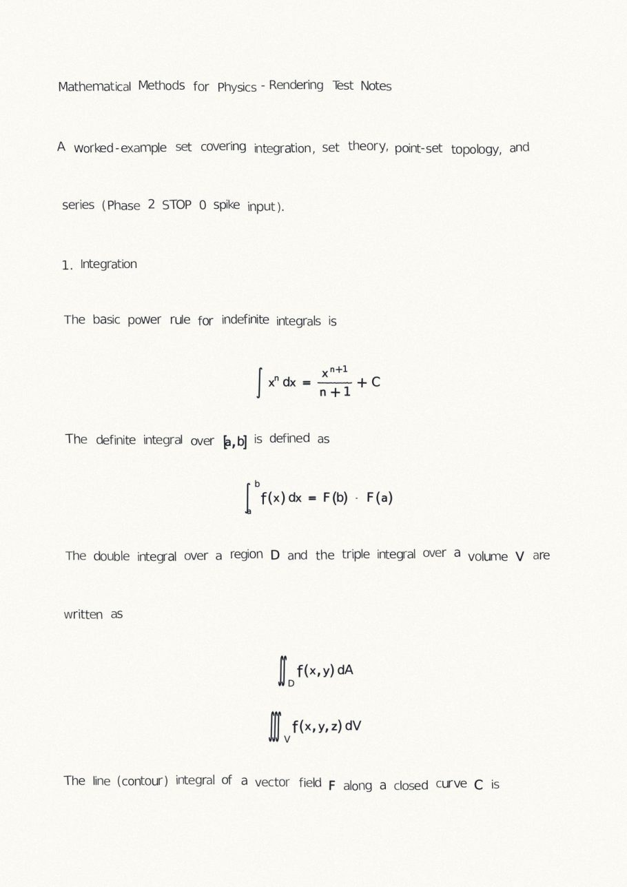
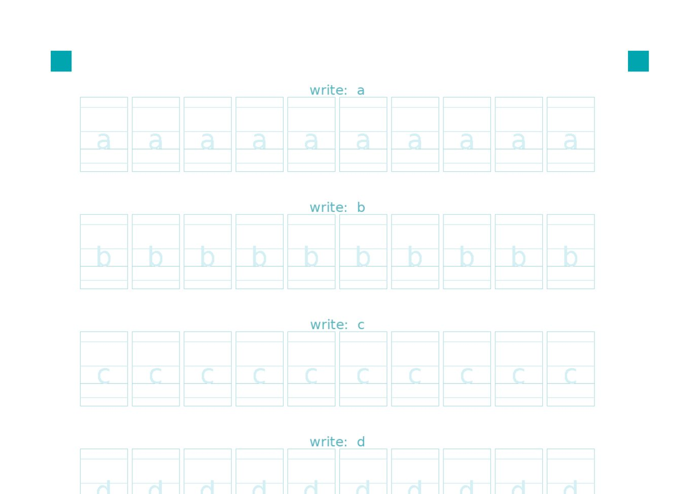

# Handwriting Converter

Turn a typed Word document — text **and** equations — into pages that look
handwritten, in **your** handwriting.

The pipeline is a set of bricks that knows nothing about any particular hand:
it lays out and draws whatever *glyph store* it is pointed at. Fill in the
included template once, import it, and every conversion after that comes out
in your writing. Out of the box it ships with a font-rendered demo store so
everything runs before you have written a single letter.

<p align="center">
  
</p>

*Rendered with the built-in demo store (a font, deliberately). Import your own
handwriting and the same page comes out in your hand.*

## What it does

- **`.docx` in, pages out** — PNG per page or one multi-page PDF, A4 at any DPI.
- **Word equations (OMML) are handwritten too**: inline equations flow in the
  line, display equations get a centred line; fractions, roots, sums/integrals
  with limits, stretched brackets, under/over-braces, boxed answers, primes,
  transposes … drawn glyph by glyph from the same store as the prose.
- **Looks like a hand, not a font**: variant selection with no immediate
  repeats, per-word slant and height walk, baseline drift, line rise, margin
  drift, size/ink jitter, optional scanned-look effects — all seeded, so the
  same seed reproduces the same page.
- **Your paper**: composite onto your own scanned notebook PDF, optionally
  snapping baselines onto its printed rules (auto-detected).
- **Bring your own handwriting**: printable/tablet template → write → import
  → glyph store. Two or three commands. Nothing leaves your machine.
- **Desktop GUI** (PySide6) with drag-and-drop, live preview, seed re-roll,
  and a one-click Windows build (PyInstaller; pandoc + node bundled).

## Quick start

```bash
git clone <this repo> && cd handwriting-converter
python3 -m venv .venv && .venv/bin/pip install -r requirements.txt

# convert (uses the demo store on first run; generated automatically)
.venv/bin/python -m handwriting samples/equation.docx --out out/equation.pdf

# or the GUI
.venv/bin/python -m gui
```

Equations need **pandoc** and **node** on PATH (or a pinned pandoc unpacked
at `spike/tools/pandoc-3.5/`), plus MathJax: `cd spike && npm ci` once.
Text-only documents need neither.

## Your own handwriting

<p align="center">
  
</p>

1. **Make the template** (31 A4 pages, ten samples per character; `--variants
   3` for a quicker sheet):
   ```bash
   .venv/bin/python scripts/make_template_collection.py            # → template/collection/template.pdf
   ```
   It covers English, digits, punctuation, Greek, ~90 maths symbols, tall
   delimiters and straight strokes (for fraction bars) — everything the
   equation renderer can ask for. All furniture is cyan so it can be
   colour-keyed away; the faint letter in each cell is a size guide.
2. **Write it.** On a tablet: import the PDF into a notes app (GoodNotes,
   Notability, …), write with a plain pen, export as a *flattened* PDF with the
   page background included. Print-and-scan works the same way as long as the
   cyan survives the scan (300 dpi colour).
3. **Import** it into a store:
   ```bash
   .venv/bin/python scripts/split_ipad.py my_export.pdf \
       --layout template/collection/template_layout.json --out glyphs/mine
   ```
   Cells are cropped at exact template coordinates, the cyan is removed by
   hue (dark ink is never collateral), each glyph becomes an ink-only RGBA PNG
   with its baseline read from the printed guide, and `glyphs/mine/manifest.json`
   is written. Empty cells are skipped, so a partial pass is fine — write more
   later and merge with `scripts/merge_store.py`.

That is it: any store under `glyphs/` is picked up automatically (the first
user store is the default; the GUI lists them all; `--store` / `HW_STORE`
choose explicitly).

**Store format** — a directory with `manifest.json` plus one folder per
character holding its variant PNGs (transparent, ink only) and per-variant
metrics (`baseline_y`, `advance_width`, bearings, `ink_bbox`) at a store-wide
`native_size_px`. Special keys: `big:(` … `big:√` (tall delimiters written
full height), `rule:short|med|long` (straight strokes), `math:x` (a letter
written differently inside equations). Anything missing falls back
gracefully (a symbol with no glyph is drawn as a faint box and logged).

## Command line

```bash
.venv/bin/python -m handwriting input.docx --out page.png
.venv/bin/python -m handwriting input.docx --seed 7 --dpi 300 --out out/doc.pdf
.venv/bin/python -m handwriting input.docx --store glyphs/mine --out page.png
.venv/bin/python -m handwriting input.docx --style mystyle.json --out page.png
.venv/bin/python -m handwriting input.docx --paper notebook.pdf --snap-lines --out page.png
.venv/bin/python -m handwriting input.docx --no-effects --out page.png
```

- `--out *.pdf` writes one multi-page PDF; otherwise PNGs (`<stem>_pN.png`).
- `--seed N` — same input + seed + style ⇒ pixel-identical pages.
- `--style file.json` — any subset of `HandwritingStyle` fields
  (`handwriting/style.py`): letter size, slant, drift, gaps, ink colour,
  jitters, `display_math_gap`, … .
- `--paper bg.pdf` (+ `--paper-fit cover|stretch|contain`) — your paper under
  the ink; `--snap-lines` puts baselines on its printed rules (auto-detected;
  `--rule-spacing/--rule-offset/--rule-margin-x` override). Auto-detected
  paper is written down to its last printed rule.
- Pages are filled to the bottom. A page changes early only at a Word page
  break (Ctrl+Enter), or to keep reserved space whole: a run of two or more
  blank lines (room left for a figure) is never split across pages, and a
  one- or two-line caption right above it moves with it.
- `--word-pages` — follow Word's own pages instead: a new page starts wherever
  Word's last layout began one (the markers Word saves in the .docx), and blank
  lines typed to push content onto the next Word page are dropped. A handwriting
  page holds more than a Word page, so these pages end part-empty; a Word page
  too long for one page spills onto an extra one. Files not saved by Word carry
  no markers and simply flow. Off by default (a checkbox in the GUI).
- `--no-effects` — plain clean ink instead of the scanned-look chain.

## Desktop GUI and the Windows build

`python -m gui`: drop a `.docx` (document → handwriting pages; or "equation
sheet" mode for a numbered sheet of just the equations) or a `.txt` list of
LaTeX (one per line → labelled contact sheet). Pick the store, seed, paper,
snapping, DPI, effects and the advanced knobs, convert, preview, re-roll,
save. Conversion runs on a worker thread; equation renders are cached per
equation, so re-converting the same document is fast.

The advanced options are remembered between runs, and can be stored under a
name ("설정 모음") to switch between sets. The save dialog opens in the folder
you set as the default, else the one you last saved into, else the folder the
input file came from. All of it lives in one JSON in the per-user config
directory (`%LOCALAPPDATA%\handwriting-converter\settings.json` on Windows,
`~/.config/handwriting-converter/` elsewhere), so replacing the app folder on
an update does not lose it.

To build a self-contained Windows app: on a Windows machine with Python 3.11+
run `packaging\build_windows.bat`. It creates a build venv, fetches pinned
pandoc + node, runs PyInstaller (bundling every store under `glyphs/`), and
self-checks the bundle. Ship `dist\HandwritingConverter\`; users run the exe
inside — nothing to install. Keep the folder on an ASCII path (the bundled
node dies silently on non-ASCII script paths). Private builds can rename the
app with `packaging/app_name.local.txt` and give it their own icon with
`scripts/make_app_icon.py --local` — both gitignored.

## How it works

```
.docx ──parser──▶ Document Model ──layout──▶ placed glyphs ──variation──▶ renderer ──▶ paper compositor ──▶ PNG/PDF
          │                              ▲
          └─ OMML equations ─ pandoc ─▶ LaTeX ─▶ MathJax SVG ─▶ placement ─▶ glyph substitution ─▶ ink image ┘
```

- **Parser** (`handwriting/parser.py`) walks each paragraph in run order and
  emits text runs and `MathBlock`s (inline vs display), honouring soft breaks
  and page breaks.
- **Layout** (`layout.py`) packs words by per-row ink kerning (crossbars and
  tails nest), wraps, drifts baselines, snaps to ruled paper, and seats
  equation images so their cap height matches the body letters; tall
  equations push neighbouring lines clear.
- **Equations** (`mathrender.py` + `spike/`): one pandoc pass extracts LaTeX
  for every equation in document order; MathJax typesets it to SVG;
  `parse_svg.py` reads every glyph's position/size and every rule/frame;
  `render_placement.py` substitutes store glyphs — normal-size symbols by
  cap-height rule, tall delimiters by stretching only their straight run,
  large operators by uniform scaling with a skeleton re-stroke so the pen
  weight stays constant, braces/frames/fraction bars from real pen strokes.
- **Variation / renderer / compositor** apply the seeded hand rhythm, paste
  and recolour ink, and lay it on paper with optional scan effects.

Every stage is checked by `scripts/verify.sh` (checkpoint and feature checks,
goldens for the text path, geometry assertions for the equation path). It is
the definition of done for this repo: `./scripts/verify.sh` must pass.

## Limits and notes

- Characters the store has no glyph for are skipped in prose (logged) and
  drawn as faint boxes in equations. The template covers Latin, Greek and
  common maths; other scripts need their own charset file
  (`--charset`, one entry per line) — the tools are charset-agnostic.
- Inline equations use TeX text style (small fraction parts); Word's
  full-size inline stacks are not reproduced.
- The demo store is a font: it proves the pipeline, not the illusion. The
  handwritten look comes entirely from the store you import.
- Text-only paths are byte-reproducible per seed; equation renders are
  reproducible per seed + LaTeX (and cached under the chain's work dir).

## Repository layout

- `handwriting/` — the pipeline package (parser, layout, variation, renderer,
  compositor, math bridge, style, glyph store, demo store, store registry)
- `gui/` — PySide6 desktop shell; `packaging/` — Windows build
- `spike/` — the equation chain (MathJax script, SVG parser, glyph placement)
- `scripts/` — template generators, importers, and every check (`verify.sh`)
- `template/` — charset files and template layouts; `samples/` — fixtures
- `glyphs/` — glyph stores (yours; `demo`/`synthetic` are generated, gitignored)

## License

MIT — see `LICENSE`. DejaVu Sans (bundled for metrics and the demo store) is
under its own licence in `handwriting/data/`.
